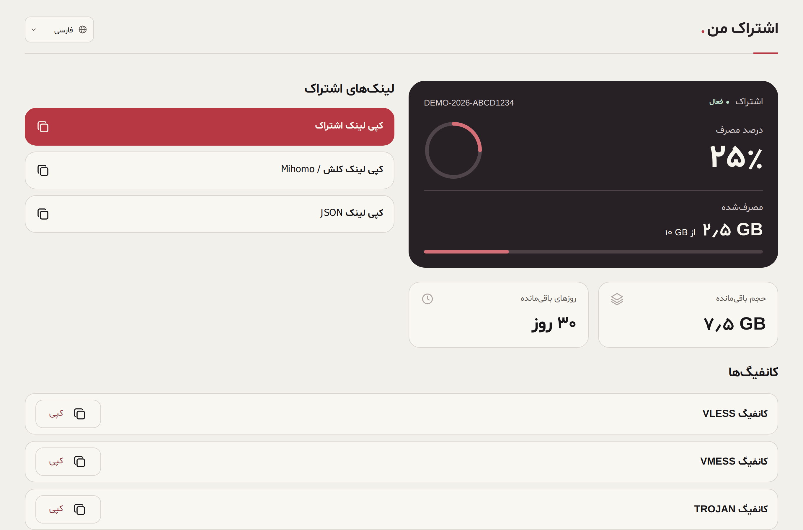
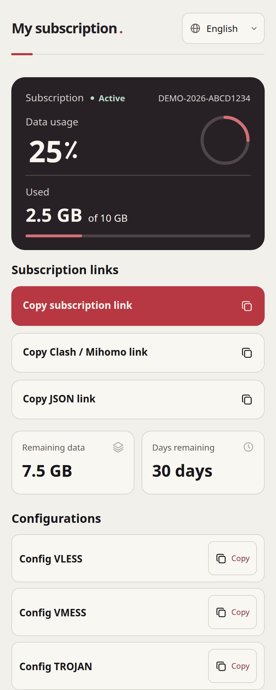
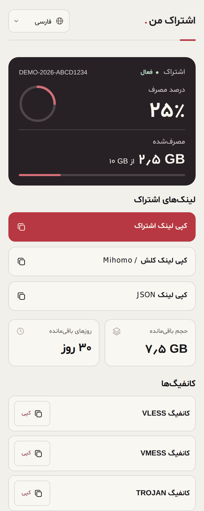

# Subscription Theme

A multilingual subscription page for PasarGuard and 3x-ui. Users can check their remaining data and time, then copy a subscription link or an individual config.

## Previews

### Desktop

| English | فارسی |
| --- | --- |
|  |  |

### Mobile

| English | فارسی |
| --- | --- |
|  |  |

## Install

Copy the template for your panel. Each file includes its own styles, scripts, and embedded Shabnam and Noto fonts.

| Panel | Template |
| --- | --- |
| PasarGuard | [index.html](themes/pasarguard/index.html) |
| 3x-ui | [sub.html](themes/3x-ui/sub.html) |

See the [installation guide](INSTALL.md) for the settings on each panel.

## Edit the theme

The two templates share the layout and styles in `src/`. The files in `adapters/` tell the page how to read each panel's subscription data.

After making changes, rebuild both templates and commit the files under `themes/`.

```sh
python3 tools/build.py
